

 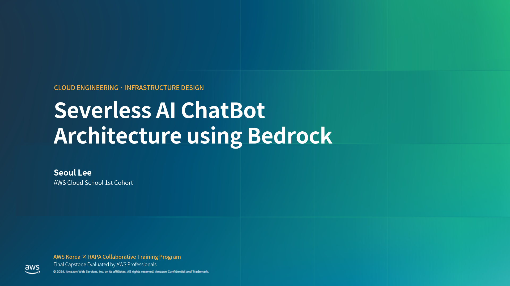
 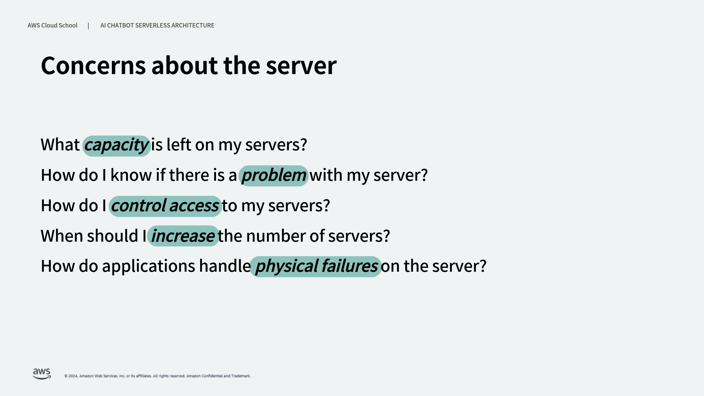
 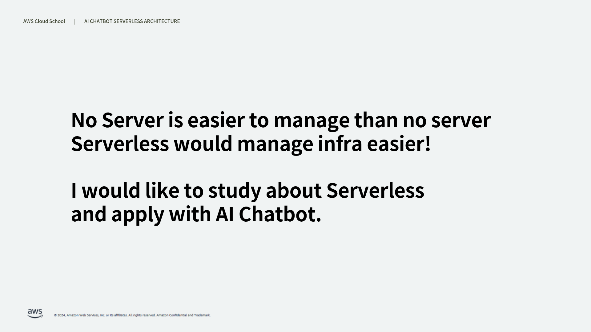
 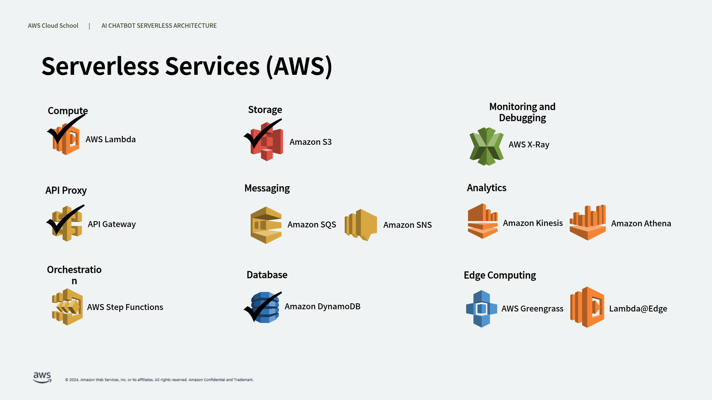
 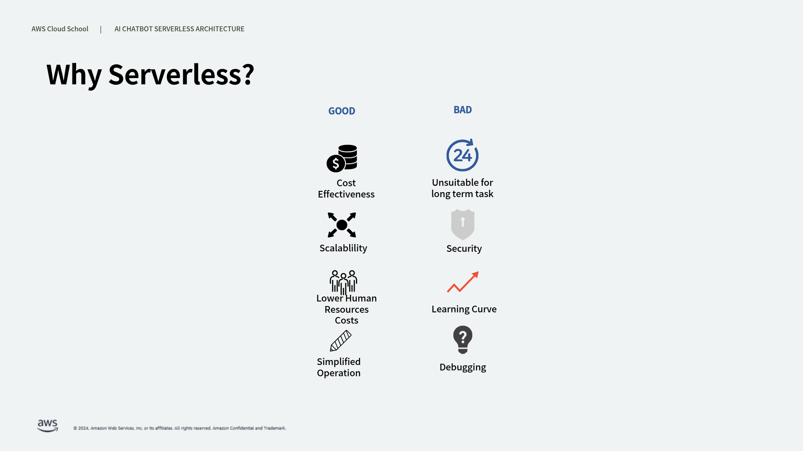
 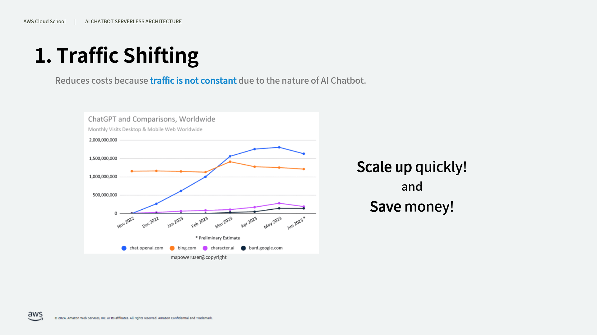
 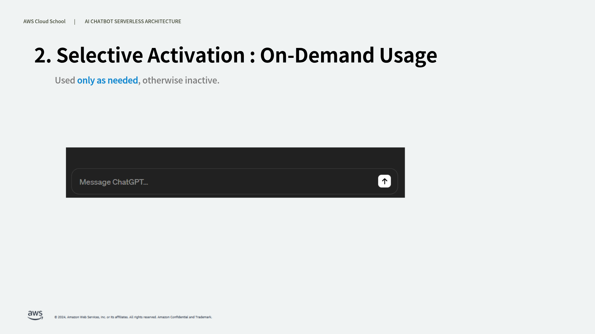
 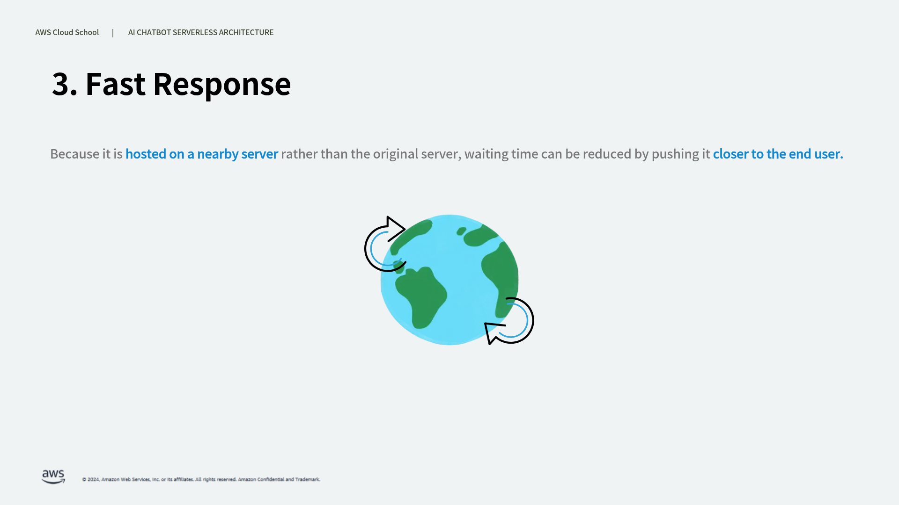
 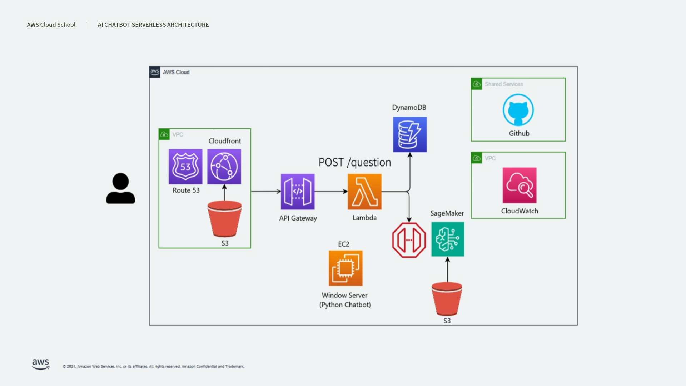
 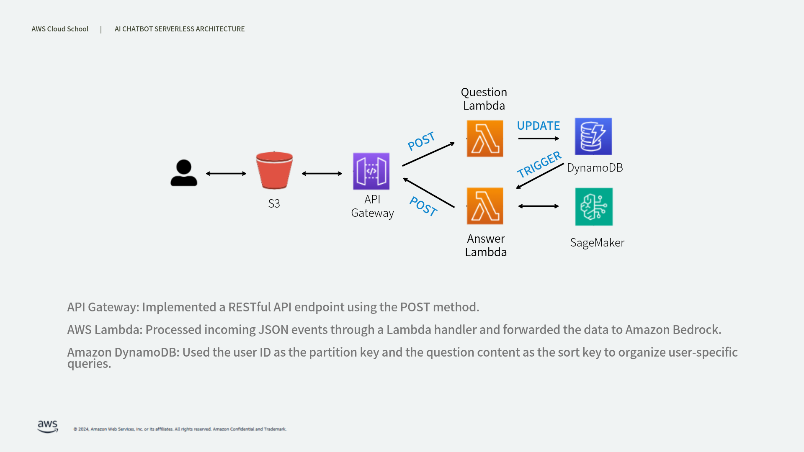
 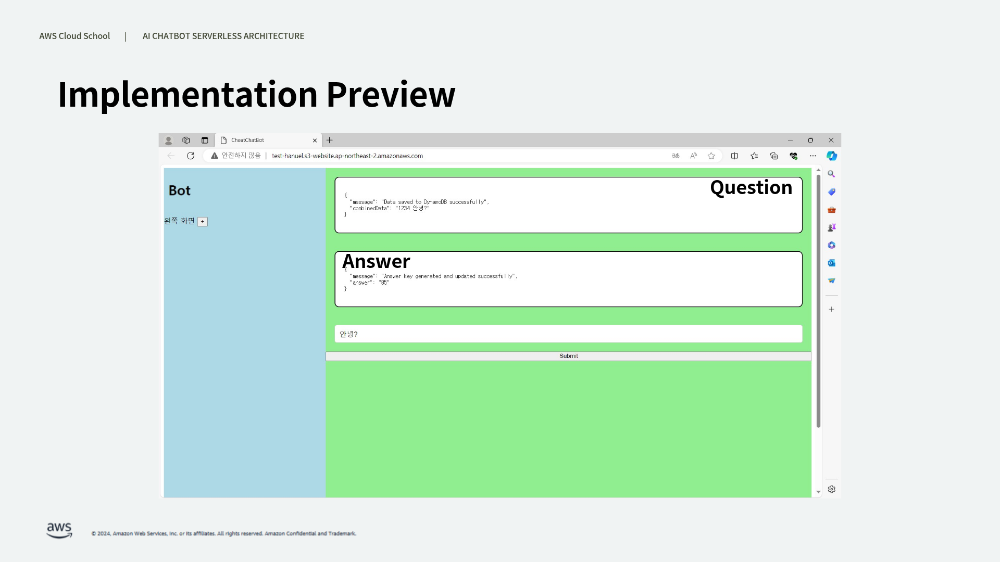
 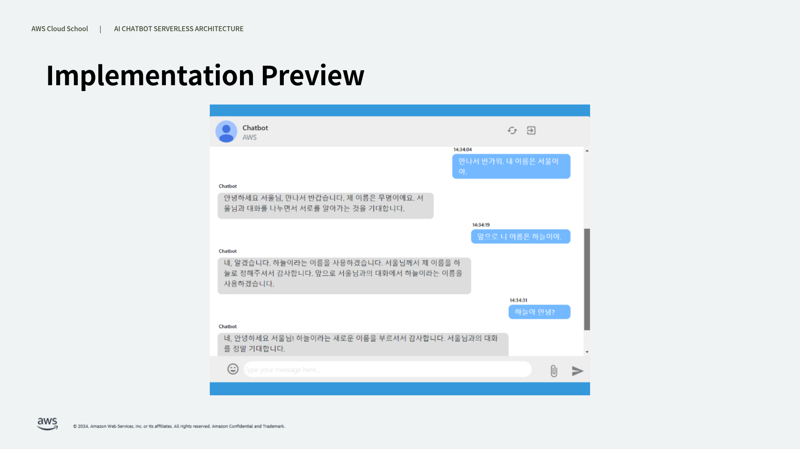
 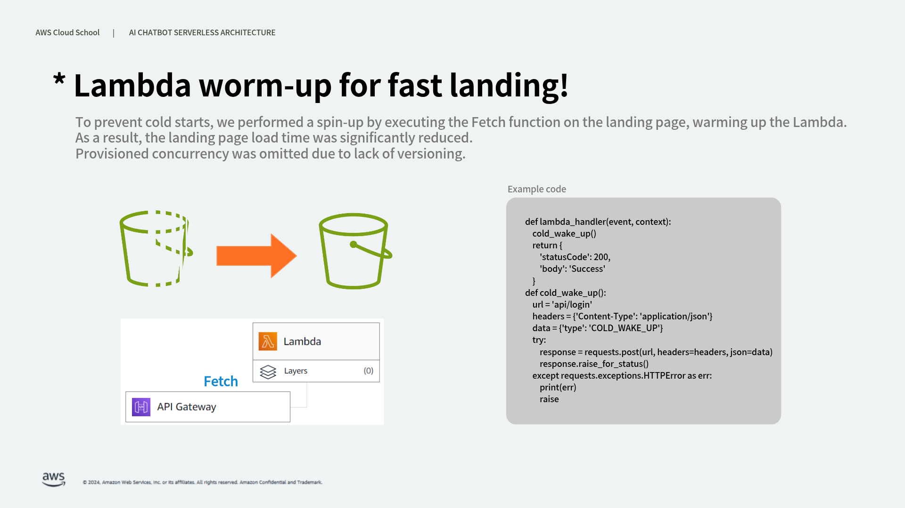
 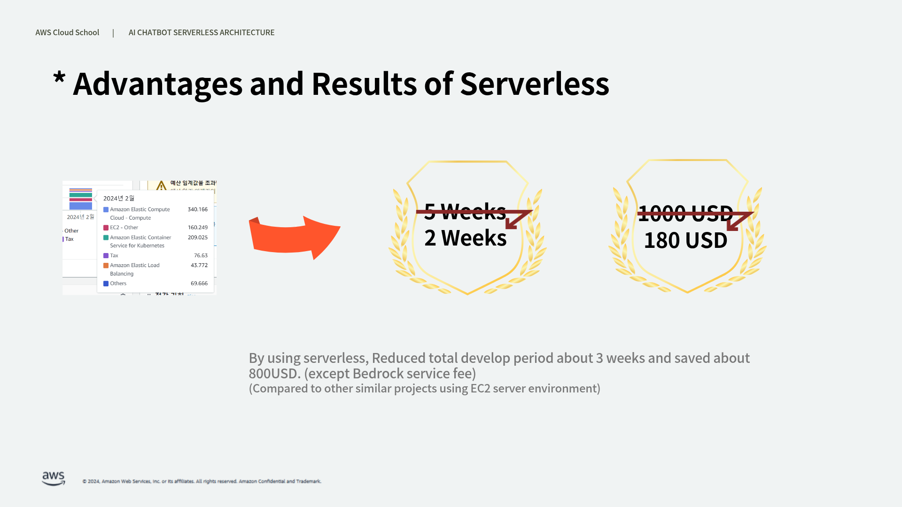
 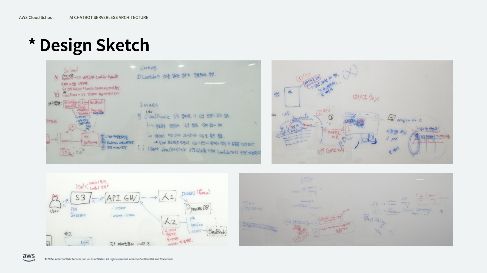
 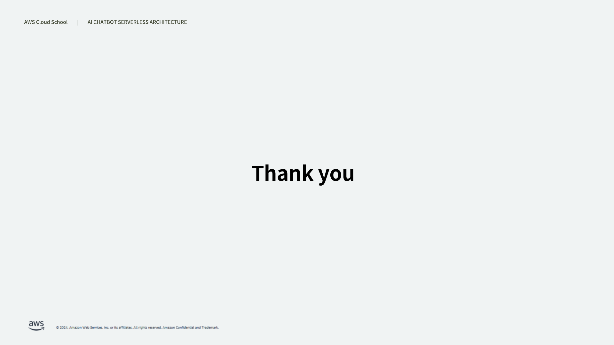

Development History
  
March.17.24 Completed the initial frontend and backend implementation, including integration with Amazon Bedrock.

March.24.24 Continued development of the AI server.

